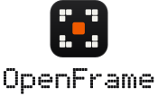

   
  
  
   
   

  <picture>
    <source media="(prefers-color-scheme: dark)" srcset="web/src/lib/assets/openframe/openframe-stacked-dark.svg">
    
  </picture>

<h3 align="center">A self-hosted photo and video library, forked from Immich</h3>
 

OpenFrame is a fork of [Immich](https://github.com/immich-app/immich). It keeps Immich's features, data model, API and mobile app compatibility, and works on making the app faster and easier to use. Everything here is built on the work of the Immich team and contributors, and stays under the same [AGPLv3 license](LICENSE).

The project site is **[immich.yash0.in](https://immich.yash0.in)**.

> [!WARNING]
> OpenFrame is an unofficial fork and is **not** affiliated with or endorsed by FUTO or the Immich team. Don't report OpenFrame bugs to upstream Immich.

> [!WARNING]
> ⚠️ Always follow [3-2-1](https://www.backblaze.com/blog/the-3-2-1-backup-strategy/) backup plan for your precious photos and videos!

## Goals

These are what OpenFrame is aiming for. They are **goals, not delivered features**: the next section lists what has actually shipped and been measured.

- **Faster uploads.** Less waiting between picking files and seeing them in the library, on both web and mobile.
- **Better mobile-to-desktop connection.** Make moving photos between a phone and a desktop session quicker and more reliable.
- **A redesigned UI.** A clearer, calmer interface with its own identity, not a reskin of upstream.
- **Better UX.** Fewer dead ends, clearer progress and state, and fewer clicks for common tasks.
- **Outperform current upstream without regressions.** Every speed claim needs a before-and-after measurement against the upstream base commit, and no feature, API or client compatibility may be lost.

## What has shipped

| Change | Area | Evidence |
| :----- | :--- | :------- |
| `LIMIT 1` on the random-face query, async bcrypt checks, one fewer `fs.access` call per media request | Server | Focused benchmarks against upstream `256eb55`, published at [immich.yash0.in/performance](https://immich.yash0.in/performance.html). Synthetic and per-change, not an end-to-end speedup. |
| OpenFrame branding: logo, favicons, page titles and PWA name | Web | Visual change only. Identifiers that clients and existing installs depend on keep their `immich` names. |
| Self-hosted Geist and Geist Mono typography | Web | Preloaded font files changed from 4,971,652 B to 69,560 B. Static file sizes only; no page-load-time claim. Other scripts use platform font fallback. [Evidence](https://immich.yash0.in/data/raw/font-payload.json). |
| Overall upload progress: one size-weighted progress bar with bytes processed and combined speed, and a progress ring on the minimized upload button | Web | Unit tests in `web/src/lib/stores/upload.spec.ts`. The progress UI itself is not a speed change; it shows how far along uploads are. |
| OpenFrame app names, in-app mark, launcher and splash assets | Android / iOS | Asset dimensions and resource references checked. Full native builds have not been run. |
| `openframe` CLI command with the existing `immich` alias retained | CLI | Production build, type-check, lint, formatting and 45 tests pass on Node 24. |

Against Immich v3.3.5, the fixed default-worker experiment showed 16.27% lower paired HTTP completion latency and 15.57% lower thumbnail/preview readiness latency. Both exploratory intervals lie below zero, but this is one shared host with ML disabled and small sequential PNGs. The earlier small smoke was 4.7% slower and remains inconclusive; the separate API-only experiment showed 8.75% lower paired latency. See the [HTTP comparison](https://immich.yash0.in/http-comparison) for all outcomes and raw evidence. Video, concurrent load, populated libraries, ML, WAN and mobile connectivity remain unmeasured.

Results come in two kinds, and they're kept apart:

- **Base-commit benchmarks** compare OpenFrame with the upstream commit it forked from (`256eb55`). The server results above are this kind.
- **Release comparisons** compare OpenFrame with the latest stable Immich release (v3.3.5). The [upload-check comparison](https://immich.yash0.in/release-comparison) measures elapsed time for one CPU-focused server method against an in-memory repository: 16.5–37.9% lower method time across nine synthetic workloads. It doesn't measure end-to-end uploads. Raw samples, source hashes and limitations are published with the results.

## Contributing, including AI-assisted pull requests

Pull requests are welcome, and **AI-assisted pull requests are explicitly welcome**. They're especially useful for:

- **Performance:** profiling, removing wasted work, faster uploads and media delivery
- **Implementations:** features that move a goal above forward
- **UX:** clearer flows, accessibility and the redesign
- **Tests:** coverage for changed code and regression tests

Using an AI tool doesn't change who is responsible for the change. If you open a PR, you're its author:

1. **Understand it.** Read and be able to explain every line you submit.
2. **Verify it.** Run the relevant tests, lint and type checks, and say in the PR what you ran and what you didn't.
3. **Measure performance claims.** Show before and after numbers against the upstream base commit, with the machine, run count and median or mean. Don't claim a speedup you didn't measure.
4. **Keep compatibility.** Don't break the API, the mobile apps, existing data or upstream attribution.
5. **Say how it was made.** Note in the PR description that AI tools were used, and which parts they wrote.

OpenFrame uses Immich's translations. Some strings still say 'Immich' where a language changes the form of the name; translator contributions are welcome.

See the [OpenFrame contribution guide](CONTRIBUTING.md) for the full rules. Upstream's [developer docs](https://docs.immich.app/developer/setup) still cover local setup.

## Upstream Immich

OpenFrame builds on upstream Immich. For installation, configuration and the full documentation, use the upstream resources:

- [Documentation](https://docs.immich.app/)
- [Installation](https://docs.immich.app/install/requirements)
- [Roadmap](https://immich.app/roadmap)
- [Translations](https://docs.immich.app/developer/translations)
- [Support the Immich project](https://docs.immich.app/overview/support-the-project)

Translated versions of the upstream Immich README:

  <a href="readme_i18n/README_ca_ES.md">Català</a>
  <a href="readme_i18n/README_es_ES.md">Español</a>
  <a href="readme_i18n/README_fr_FR.md">Français</a>
  <a href="readme_i18n/README_it_IT.md">Italiano</a>
  <a href="readme_i18n/README_ja_JP.md">日本語</a>
  <a href="readme_i18n/README_ko_KR.md">한국어</a>
  <a href="readme_i18n/README_de_DE.md">Deutsch</a>
  <a href="readme_i18n/README_nl_NL.md">Nederlands</a>
  <a href="readme_i18n/README_tr_TR.md">Türkçe</a>
  <a href="readme_i18n/README_zh_CN.md">简体中文</a>
  <a href="readme_i18n/README_zh_TW.md">正體中文</a>
  <a href="readme_i18n/README_uk_UA.md">Українська</a>
  <a href="readme_i18n/README_ru_RU.md">Русский</a>
  <a href="readme_i18n/README_bg_BG.md">Български</a>
  <a href="readme_i18n/README_pt_BR.md">Português Brasileiro</a>
  <a href="readme_i18n/README_sv_SE.md">Svenska</a>
  <a href="readme_i18n/README_ar_JO.md">العربية</a>
  <a href="readme_i18n/README_vi_VN.md">Tiếng Việt</a>
  <a href="readme_i18n/README_th_TH.md">ภาษาไทย</a>
  <a href="readme_i18n/README_ml_IN.md">മലയാളം</a>

## Features inherited from Immich

| Features                                     | Mobile | Web |
| :------------------------------------------- | ------ | --- |
| Upload and view videos and photos            | Yes    | Yes |
| Auto backup when the app is opened           | Yes    | N/A |
| Prevent duplication of assets                | Yes    | Yes |
| Selective album(s) for backup                | Yes    | N/A |
| Download photos and videos to local device   | Yes    | Yes |
| Multi-user support                           | Yes    | Yes |
| Album and Shared albums                      | Yes    | Yes |
| Scrubbable/draggable scrollbar               | Yes    | Yes |
| Support raw formats                          | Yes    | Yes |
| Metadata view (EXIF, map)                    | Yes    | Yes |
| Search by metadata, objects, faces, and CLIP | Yes    | Yes |
| Administrative functions (user management)   | No     | Yes |
| Background backup                            | Yes    | N/A |
| Virtual scroll                               | Yes    | Yes |
| OAuth support                                | Yes    | Yes |
| API Keys                                     | N/A    | Yes |
| LivePhoto/MotionPhoto backup and playback    | Yes    | Yes |
| Support 360 degree image display             | No     | Yes |
| User-defined storage structure               | Yes    | Yes |
| Public Sharing                               | Yes    | Yes |
| Archive and Favorites                        | Yes    | Yes |
| Global Map                                   | Yes    | Yes |
| Partner Sharing                              | Yes    | Yes |
| Facial recognition and clustering            | Yes    | Yes |
| Memories (x years ago)                       | Yes    | Yes |
| Offline support                              | Yes    | No  |
| Read-only gallery                            | Yes    | Yes |
| Stacked Photos                               | Yes    | Yes |
| Tags                                         | No     | Yes |
| Folder View                                  | Yes    | Yes |

## Translations

OpenFrame uses Immich's translations. Read more about them [here](https://docs.immich.app/developer/translations).

## Repository history

This repository starts from a snapshot of OpenFrame with one initial commit. Earlier Immich and OpenFrame commits, pull requests, issues and releases are not imported. OpenFrame remains a fork of Immich; the original license and copyright notices are preserved.

## License and attribution

OpenFrame is licensed under the [GNU Affero General Public License v3.0](LICENSE), the same license as Immich. Immich is developed by the Immich team and its contributors, and the Immich name and logos belong to their owners. OpenFrame uses the Immich name only to describe where it comes from.
