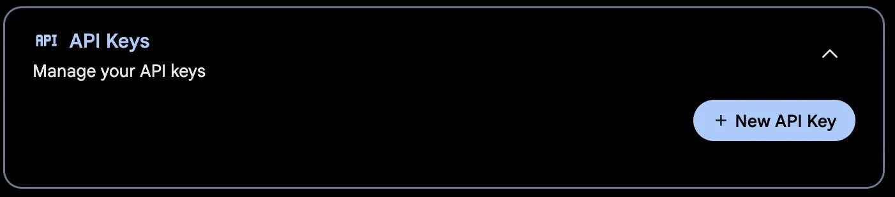
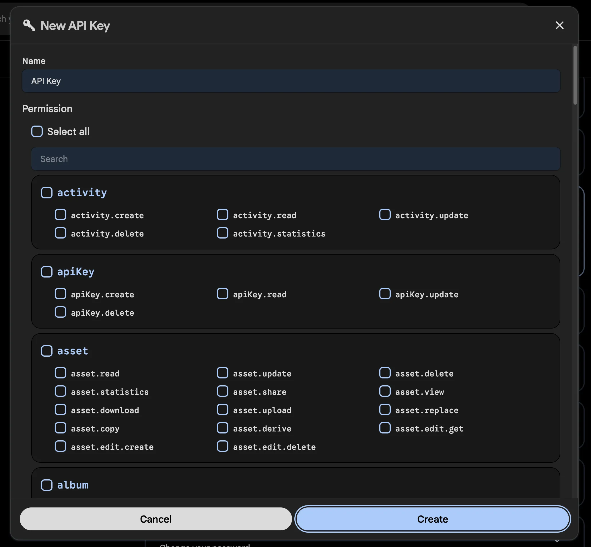

# The Immich CLI

Immich has a command line interface (CLI) that allows you to perform certain actions from the command line.

## Features

- Upload photos and videos to Immich
- Check server version

More features are planned for the future.

:::tip Google Photos Takeout
If you are looking to import your Google Photos takeout, we recommend this community maintained tool [immich-go](https://github.com/simulot/immich-go)
:::

## Requirements

- Node.js 22 or above
- Npm

If you can't install node/npm, there is also a Docker version available below.

## Installation (NPM)

```bash
npm i -g @immich/cli
```

NOTE: if you previously installed the legacy CLI, you will need to uninstall it first:

```bash
npm uninstall -g immich
```

## Installation (Docker)

If npm is not available on your system you can try the Docker version

```bash
docker run -it -v "$(pwd)":/import:ro -e IMMICH_INSTANCE_URL=https://your-immich-instance/api -e IMMICH_API_KEY=your-api-key ghcr.io/immich-app/immich-cli:latest
```

Please modify the `IMMICH_INSTANCE_URL` and `IMMICH_API_KEY` environment variables as suitable. You can also use a Docker env file to store your sensitive API key.

This `docker run` command will directly run the command `immich` inside the container. You can directly append the desired parameters (see under "usage") to the commandline like this:

```bash
docker run -it -v "$(pwd)":/import:ro -e IMMICH_INSTANCE_URL=https://your-immich-instance/api -e IMMICH_API_KEY=your-api-key ghcr.io/immich-app/immich-cli:latest upload -a -c 5 --recursive directory/
```

## Usage

<details>
<summary>Usage</summary>

```
$ immich
Usage: immich [options] [command]

Command line interface for Immich

Options:
  -V, --version                       output the version number
  -d, --config-directory <directory>  Configuration directory where auth.yml will be stored (default: "~/.config/immich/", env:
                                      IMMICH_CONFIG_DIR)
  -u, --url [url]                     Immich server URL (env: IMMICH_INSTANCE_URL)
  -k, --key [key]                     Immich API key (env: IMMICH_API_KEY)
  -h, --help                          display help for command

Commands:
  login|login-key <url> <key>         Login using an API key
  logout                              Remove stored credentials
  server-info                         Display server information
  upload [options] [paths...]         Upload assets
  help [command]                      display help for command
```

</details>

## Commands

The upload command supports the following options:

<details>
<summary>Options</summary>

```
Usage: immich upload [paths...] [options]

Upload assets

Arguments:
  paths                       One or more paths to assets to be uploaded

Options:
  -r, --recursive             Recursive (default: false, env: IMMICH_RECURSIVE)
  -i, --ignore <pattern>      Pattern to ignore (env: IMMICH_IGNORE_PATHS)
  -h, --skip-hash             Don't hash files before upload (default: false, env: IMMICH_SKIP_HASH)
  -H, --include-hidden        Include hidden folders (default: false, env: IMMICH_INCLUDE_HIDDEN)
  -a, --album                 Automatically create albums based on folder name (default: false, env: IMMICH_AUTO_CREATE_ALBUM)
  -A, --album-name <name>     Add all assets to specified album (env: IMMICH_ALBUM_NAME)
  --visibility <visibility>   Set the visibility of uploaded assets (choices: "archive", "timeline", "hidden", "locked", env: IMMICH_VISIBILITY)
  -n, --dry-run               Don't perform any actions, just show what will be done (default: false, env: IMMICH_DRY_RUN)
  -c, --concurrency <number>  Number of assets to upload at the same time (default: 4, env: IMMICH_UPLOAD_CONCURRENCY)
  -j, --json-output           Output detailed information in json format (default: false, env: IMMICH_JSON_OUTPUT)
  --delete                    Delete local assets after upload (env: IMMICH_DELETE_ASSETS)
  --delete-duplicates         Delete local assets that are duplicates (already exist on server) (env: IMMICH_DELETE_DUPLICATES)
  --no-progress               Hide progress bars (env: IMMICH_PROGRESS_BAR)
  --watch                     Watch for changes and upload automatically (default: false, env: IMMICH_WATCH_CHANGES)
  --help                      display help for command
```

</details>

Note that the above options can read from environment variables as well.

## Quick Start

You begin by authenticating to your Immich server. For instance:

```bash
# immich login [url] [key]
immich login http://192.168.1.216:2283/api HFEJ38DNSDUEG
```

This will store your credentials in a `auth.yml` file in the configuration directory which defaults to `~/.config/immich/`. The directory can be set with the `-d` option or the environment variable `IMMICH_CONFIG_DIR`. Please keep the file secure, either by performing the logout command after you are done, or deleting it manually.

Once you are authenticated, you can upload assets to your Immich server.

```bash
immich upload file1.jpg file2.jpg
```

By default, subfolders are not included. To upload a directory including subfolder, use the --recursive option:

```bash
immich upload --recursive directory/
```

If you are unsure what will happen, you can use the `--dry-run` option to see what would happen without actually performing any actions.

```bash
immich upload --dry-run --recursive directory/
```

By default, the upload command will hash the files before uploading them. This is to avoid uploading the same file multiple times. If you are sure that the files are unique, you can skip this step by passing the `--skip-hash` option. Note that Immich always performs its own deduplication through hashing, so this is merely a performance consideration. If you have good bandwidth it might be faster to skip hashing.

```bash
immich upload --skip-hash --recursive directory/
```

You can automatically create albums based on the folder name by passing the `--album` option. This will automatically create albums for each uploaded asset based on the name of the folder they are in.

```bash
immich upload --album --recursive directory/
```

You can also choose to upload all assets to a specific album with the `--album-name` option.

```bash
immich upload --album-name "My summer holiday" --recursive directory/
```

It is possible to skip assets matching a glob pattern by passing the `--ignore` option. See [the library documentation](docs/features/libraries.md) on how to use glob patterns. You can add several exclusion patterns if needed.

```bash
immich upload --ignore **/Raw/** --recursive directory/
```

```bash
immich upload --ignore **/Raw/** **/*.tif --recursive directory/
```

By default, hidden files are skipped. If you want to include hidden files, use the `--include-hidden` option:

```bash
immich upload --include-hidden --recursive directory/
```

You can set the visibility of uploaded assets to `archive`, `timeline`, `hidden`, or `locked` with the `--visibility` option:

```bash
immich upload --visibility archive --recursive directory/
```

You can use the `--json-output` option to get a json printed which includes
three keys: `newFiles`, `duplicates` and `newAssets`. Due to some logging
output you will need to strip the first three lines of output to get the json.
For example to get a list of files that would be uploaded for further
processing:

```bash
immich upload --dry-run --json-output . | tail -n +6 | jq .newFiles[]
```

### Obtain the API Key

The API key can be obtained in the user setting panel on the web interface. You can also specify permissions for the key to limit its access.





## Desktop folder sync

OpenFrame adds `openframe sync <folder>`. The `immich` alias accepts the same command.
Log in with `openframe login <url> <key>` first, or use the existing `IMMICH_INSTANCE_URL`
and `IMMICH_API_KEY` environment variables. The folder must already exist.

```bash
# Recursively upload new/changed media, then watch for changes.
openframe sync ~/Pictures

# Also download your missing server originals, checking the server every minute.
openframe sync ~/Pictures --download

# Run one pass for cron or a systemd timer. Failures return a nonzero exit status.
openframe sync ~/Pictures --download --once

# Preview transfers and explicit deletion propagation without changing data or state.
openframe sync ~/Pictures --download --propagate-local-deletions --dry-run --once

# Use the existing upload album conventions. --album and --album-name are exclusive.
openframe sync ~/Pictures --album
openframe sync ~/Pictures --album-name "Desktop photos"

# Filter downloads independently of upload album mapping.
openframe sync ~/Pictures --download --download-album "Family"
```

| Option                         | Behavior                                                                                                                                                               |
| ------------------------------ | ---------------------------------------------------------------------------------------------------------------------------------------------------------------------- |
| `--once`                       | Run one pass and exit instead of watching.                                                                                                                             |
| `--download`                   | Download missing originals owned by the authenticated user.                                                                                                            |
| `--download-album <name>`      | Limit downloads to exactly one album matching this name. Requires `--download`. Shared assets owned by others are excluded.                                            |
| `--template <template>`        | Relative download path. Default: `YYYY/MM/{originalFileName}`. Tokens: `YYYY`, `MM`, `DD`, `{originalFileName}`, `{assetId}`. Dates use UTC.                           |
| `-a, --album`                  | Create upload albums from immediate parent folder names, like `upload --album`.                                                                                        |
| `-A, --album-name <name>`      | Add uploaded assets to the named album, like `upload --album-name`.                                                                                                    |
| `-i, --ignore <pattern>`       | Ignore this upload glob, using the existing upload matching convention.                                                                                                |
| `-H, --include-hidden`         | Include hidden media in the recursive upload scan.                                                                                                                     |
| `--propagate-local-deletions`  | Move tracked server assets to trash when their local files disappear and no scanned copy or other tracked local path remains. Never permanently deletes server assets. |
| `--propagate-server-deletions` | Delete tracked local files after the server confirms trash or HTTP 404. Keep locally modified files and sidecars.                                                      |
| `-n, --dry-run`                | Preview actions without transferring, deleting, modifying albums, or saving state. A temporary process lock still prevents concurrent runs.                            |

Sync uses the existing bulk upload checksum check, upload retries, sidecar upload, and album
mapping. Changed files create new server assets; they do not overwrite or remove older versions.
New/changed files must keep the same size and modification time for one second before hashing.
If a file changes during that check, sync defers the entire pass, including deletions. With `--once`,
this returns a nonzero exit status so the next scheduled run can retry.
The watcher also waits for writes to finish. Pause a producer that writes with long gaps before
syncing its output. Unchanged files reuse their cached checksum. Edits that preserve both file
size and modification time require touching the file to trigger a new checksum.

Downloads stream to private temporary files, verify the server SHA-1, then publish without
replacing an existing file. Filename collisions use `<name>-<assetId>.<extension>`, followed by a
numeric suffix if necessary. Unsafe filename characters are replaced. Absolute paths, traversal,
and symlink destinations are rejected. The destination filesystem must support hard links.
Templates affect future downloads; changing one does not move tracked files. Upload exclusions
and hidden-file settings do not filter downloads.

### State and deletion safety

The folder contains `.openframe-sync.json`, written atomically with owner-only permissions.
Keeping state beside the data makes a folder move and its deletion history travel together,
and avoids platform-specific XDG paths. It contains no API key, but includes private filenames:

```json
{
  "version": 1,
  "serverUrl": "https://photos.example.com/api",
  "userId": "00000000-0000-4000-8000-000000000001",
  "entries": [
    {
      "path": "2026/10/photo.jpg",
      "checksum": "a94a8fe5ccb19ba61c4c0873d391e987982fbbd3",
      "assetId": "00000000-0000-4000-8000-000000000002",
      "size": 4,
      "mtimeMs": 1793145600000
    }
  ]
}
```

Checksums are hexadecimal SHA-1; paths are relative and use `/`. The state is bound to the server
URL and account. Invalid state or a different account stops sync without resetting the file.
Keep this file out of other backup import tools.

By default, deletion never propagates. Missing tracked paths remain in state, so restarting sync
does not download them again or recreate server assets removed by another client. Neither flag
applies to files that have never been synced. Removing an asset from an album is not a server
deletion. A network/permission error is not treated as a server deletion. Always preview deletion
flags with `--dry-run --once`; an unmounted drive can look like locally deleted files. Removing
state resets the deletion history, so previously removed assets may download again.
Upload exclusions and hidden-file settings also prevent local deletions in those paths from
propagating to the server.

Sync serializes passes and retries transient requests up to three times. Metadata requests time out after
two minutes; transfers have a thirty-minute limit. A failed pass in watch mode is retried on a later filesystem event or the next
one-minute poll. Ctrl+C or SIGTERM cancels network work, saves completed progress, closes the
watcher, and releases the lock. Failed uploads/downloads do not advance their state. An abrupt
kill can leave `.openframe-sync.lock` or `.openframe-sync-*.part`/`*.tmp` files. After confirming
no sync process is running, remove its stale lock manually before restarting. Sync does not
remove leftover temporary files from an abruptly killed process automatically.

Use an API key with asset upload/read permissions, asset download permission for `--download`,
and asset delete permission for `--propagate-local-deletions`. Album mapping also needs the
same album permissions as `upload --album` or `upload --album-name`.

### systemd user service

An example unit is provided in [openframe-sync.service](/examples/openframe-sync.service).
Save it as `~/.config/systemd/user/openframe-sync.service`, replace the executable and picture
folder paths, and log in using the same account that runs the service. Then run:

```bash
systemctl --user daemon-reload
systemctl --user enable --now openframe-sync.service
journalctl --user -u openframe-sync.service -f
```

The service watches continuously and polls the server every minute. For a systemd timer, change
`Type` to `oneshot`, add `--once` to `ExecStart`, remove `Restart` and `RestartSec`, and attach
your preferred timer schedule. No deletion flag is enabled in the example.
